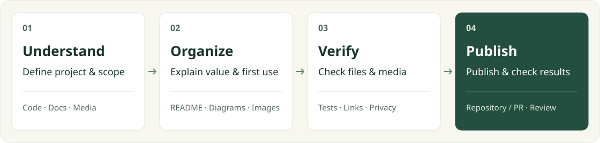

<div align="center">

<h1>GitHub Project Publisher</h1>

[简体中文](README.md) · **[English](README.en.md)**


**Turn working code into a GitHub project people can understand and use.**

[Why](#the-problem) · [Deliverables](#what-you-get) · [Workflow](#workflow) · [Start](#quick-start) · [Examples](#real-projects)

[](CHANGELOG.md)
[](skills/publish-github-project/SKILL.md)
[](docs/checks.md)
[](LICENSE)

</div>

> [!NOTE]
> Use this skill in **Codex** with your own GitHub authorization. It supports both first-time publication and updates to an existing repository's README, media, and metadata.

## The problem

Your project runs, but publishing it raises more questions: how will readers understand its value? What belongs at the top of the page? Which files can be public? Do the links, images, and videos actually work after upload?

GitHub Project Publisher connects these tasks: **understand the project → organize its presentation → check the content → publish and verify**. Descriptions come from the code and existing materials, the page follows the reader's needs, and the published result can be checked.

| Your starting point | How it helps |
| --- | --- |
| **First publication:** you have a local project | Define the publication scope, prepare the README and supporting media, set the repository description and topics, then verify the result |
| **An existing repository:** you need a better introduction or updated media | Preserve useful content and reorganize the page around the project, or update only the requested images, video, or links |

## What you get

| Deliverable | What readers or maintainers gain |
| --- | --- |
| **A clear README** | The purpose, problem, actual results, core workflow, and shortest path to getting started; consistent badges and optional Chinese/English editions |
| **Media suited to the project** | Real product screenshots, a diagram that explains collaboration, or a concrete command/input-output example; a viewing entry point when a video is available |
| **A reviewable publication scope** | Candidate files, privacy findings, the final changes, and anything that still needs checking |
| **Complete repository entry points** | A confirmed description and topics, plus existing demo or documentation links |
| **An explicit publication result** | Repository or PR links, commit and file verification, and the actual status of CI, page, and media checks |

Updates preserve the original explanation of value, responsibilities, and essential handoffs. Media replacements distinguish the source file, published version, and old references. **A better-looking page should keep the information that matters.**

## Workflow

<picture>
  <source media="(max-width: 640px)" srcset="docs/assets/workflow-mobile.en.svg">
  
</picture>

The scope determines the work. A sentence edit stays lightweight. Full publication, substantial redesigns, and video replacements also record the original content and current decisions so future updates remain reviewable.

<details>
<summary><strong>How does the README order vary by project?</strong></summary>

| Project type | Suggested reading order |
| --- | --- |
| Apps, websites, business systems | Problem → demo and screenshots → workflow → quick start |
| CLIs and libraries | Purpose → minimal input/output → installation → common operations |
| Skills and automated workflows | Use cases → deliverables → workflow → installation and first prompt |

Use a flowchart for role handoffs and an architecture diagram for component relationships. A one-step tool may need only a real example. Existing SVGs, images, and Mermaid diagrams can be reused; diagrams are included when they help explain the project. SVG workflows are also reviewed for readable text on phones.

</details>

## Quick start

### 1. Install the skill

Send this in Codex:

```text
Use $skill-installer to install the skill in this repository:
https://github.com/ZhangShixing0/publish-github-project/tree/main/skills/publish-github-project
```

After installation, invoke `publish-github-project` in your next turn. To run its helper scripts, you need **Python 3.10+ and Git**. The scripts use only the Python standard library. GitHub API verification also requires an authenticated `gh`.

<details>
<summary><strong>Manual installation or updating an existing copy</strong></summary>

Copy the complete [skills/publish-github-project](skills/publish-github-project) folder into your project's `.agents/skills/` directory, including the instructions, scripts, templates, license, and version files.

If a skill with the same name is already installed, compare and back up personal changes first. `VERSION` identifies the package version; `package-manifest.json` checks file integrity. Comparison commands are read-only and do not overwrite customizations. See the [version and installed-copy guide (Chinese)](docs/checks.md#技能版本与安装副本).

</details>

### 2. Choose your task

**Publish a project for the first time**

```text
Use $publish-github-project to prepare this project and publish it to my GitHub.
Review the files and privacy first, then design an English README suited to the project.
Explain the problem, core workflow, and shortest setup path, and verify the published result.
```

**Improve an existing repository**

```text
Use $publish-github-project to redesign this repository's README.
Preserve useful project explanations, role responsibilities, and workflows.
Use visuals supported by the actual implementation, and show the result through a branch and draft PR.
```

You first get an assessment of the project and task scope, followed by the page and verification results. First-time publication and focused updates use different scopes. Public visibility, licensing, merges, and Releases follow your authorization.

<details>
<summary><strong>Only replacing an introduction video?</strong></summary>

```text
Use $publish-github-project to replace the project introduction video with the file I am providing now.
Review this version's visuals, audio, and privacy, and confirm any necessary processing.
Update playback and download links, remove the old files and references from the current project,
preserve everything else, and verify actual playback on GitHub.
```

The original file is checked byte for byte. Compression, redaction, and editing decisions are recorded separately. Instructions for an older video do not automatically apply to a new file. Deleting a current file does not erase Git history.

</details>

## Real projects

These repositories show where the workflow has been used. Each project's capabilities, access conditions, and license are defined in its own repository.

| Project | Presentation ideas to explore |
| --- | --- |
| [**AI Study Coach · AI 督学**](https://github.com/ZhangShixing0/AI-study) | An introduction video, product overview, version entry points, and learning/teacher follow-up workflows |
| [**Feishu Legal AI Workgroup · 飞书法律文书多智能体工作群**](https://github.com/ZhangShixing0/feishu-legal-ai-workgroup) | Handoffs between two roles, real application views, an introduction video, and staged getting-started instructions |

This repository follows the same approach: preserve the explanation of value, use a centered opening for clear entry points, explain the work with a flowchart, and provide copyable installation and usage prompts.

## Frequently asked questions

<details>
<summary><strong>Can I publish without screenshots or a video?</strong></summary>

Yes. When the project can run, the skill first tries to capture the real product using demo data. If it cannot run, it explains the specific blocker and continues with evidence-backed descriptions and diagrams. Tools without a graphical interface use real commands or input/output examples. Product interfaces are never fabricated. If video is not required, the video section can be omitted.

</details>

<details>
<summary><strong>Will it automatically rebuild the entire repository?</strong></summary>

It follows your requested scope. Text, link, and media updates preserve unrelated files and accepted content. A full redesign records the original information and checks where it appears in the new page. You can also specify layouts and brand assets to retain.

</details>

<details>
<summary><strong>Do passing checks guarantee accuracy and privacy?</strong></summary>

No. Scripts can check structure, links, files, some sensitive data patterns, and hash consistency. They cannot independently establish that descriptions match the implementation or replace reviews of video frames, audio, and the actual GitHub page. Reports distinguish verified results from unfinished checks.

</details>

## Tests and verification

Clone this repository and run from its root:

```bash
python scripts/check.py
```

This runs regression tests, structure and asset checks for both README editions, badge consistency checks, publication-file auditing, and package integrity verification. Tests cover opening layouts, content preservation, diagram recognition, media replacement, the Git index, and remote verification. The local check suite needs no GitHub credentials and does not publish anything.

To check your own project separately:

```bash
python skills/publish-github-project/scripts/audit_repository.py /path/to/your-project
python skills/publish-github-project/scripts/verify_project.py /path/to/your-project --strict
python skills/publish-github-project/scripts/verify_remote.py /path/to/your-project
```

Replace the example path; quote Windows paths containing spaces. Audit reports show categories and paths without printing sensitive matched values. See [all options and limitations (Chinese)](docs/checks.md).

The repository includes a [GitHub Actions configuration template](docs/ci-check.yml) for Ubuntu / Windows and Python 3.10 / 3.12. **Online CI is not enabled.** Passing local checks does not establish that every matrix environment has passed. See the [activation guide (Chinese)](docs/checks.md#启用-github-actions).

## Documentation and maintenance

| Topic | Start here |
| --- | --- |
| Current version and changes | [Changelog (Chinese)](CHANGELOG.md) · [Package version](skills/publish-github-project/VERSION) |
| Checks, publication plans, installed-copy comparison | [Check scripts guide (Chinese)](docs/checks.md) |
| README structure and diagram choices | [Publication plan specification](skills/publish-github-project/references/publication-plan.md) |
| Consistent badges and language switching | [Opening and badge specification](skills/publish-github-project/references/readme-header.md) · [Multilingual maintenance](skills/publish-github-project/references/readme-languages.md) |
| Reporting issues or contributing | [Contributing guide (Chinese)](CONTRIBUTING.md) |

<details>
<summary><strong>Project structure and source of truth</strong></summary>

```text
skills/publish-github-project/
├── SKILL.md               Skill entry point and decisions
├── agents/                Codex display metadata
├── references/            README, media, and publishing guides
├── assets/                README starter template
├── scripts/               Check tools and regression tests
├── VERSION                Package version
└── package-manifest.json  File hashes for this version
docs/                      Usage guides and presentation assets
scripts/check.py           Repository check entry point
```

`skills/publish-github-project/` is the maintained source of the public package; installed directories are working copies. After changing the repository, update its version and manifest, complete verification, and then synchronize installed copies, preserving personal customizations first. Templates are adapted to project evidence; unused sections can be omitted.

</details>

## Security and license

New repositories default to private. Existing repositories default to updates through a branch and draft PR. The skill follows the current task scope and existing authorization; you control public visibility, licensing, merges, and Releases.

Privacy scanning is heuristic. Screenshots, videos, audio, and client materials need additional review. Deleting a current file does not remove it from history. See the [security guide (Chinese)](SECURITY.md).

This skill uses the [MIT license](LICENSE), allowing use, modification, and commercial use with the copyright and license notices retained. **Using it to publish a project does not change that project's license.**

Maintained by [ZhangShixing0](https://github.com/ZhangShixing0), based on practical project publishing and README improvement work.
