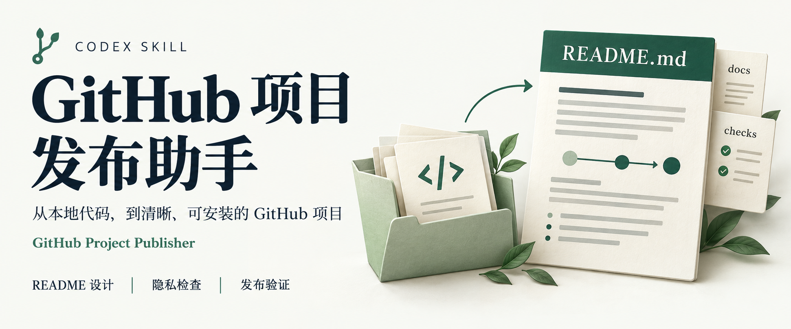
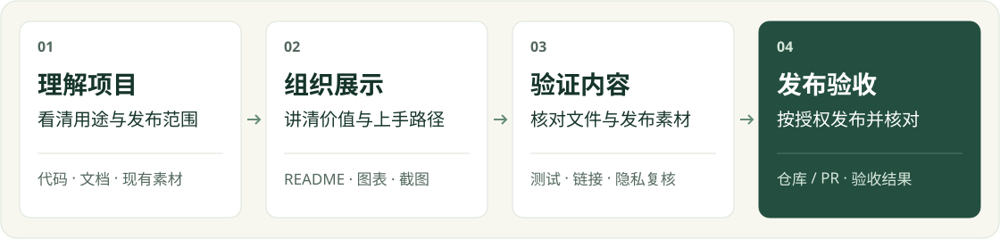

<div align="center">

<h1>GitHub 项目发布助手<br><sub>GitHub Project Publisher</sub></h1>

**[简体中文](README.md)** · [English](README.en.md)



**把能运行的代码，整理成别人看得懂、用得上的 GitHub 项目。**

[价值](#项目解决什么问题) · [交付](#你会得到什么) · [流程](#工作流程) · [上手](#快速开始) · [案例](#实际案例)

[](CHANGELOG.md)
[](skills/publish-github-project/SKILL.md)
[](docs/checks.md)
[](LICENSE)

</div>

> [!NOTE]
> 在 **Codex** 中使用，需要你自己的 GitHub 授权。既支持首次发布，也支持已有仓库的 README、素材和元数据更新。

## 项目解决什么问题

项目已经能运行，发布时却还有一串问题：怎样让别人看懂它的价值？首页应该先放什么？哪些文件可以公开？上传之后，链接、图片和视频是否真的可用？

GitHub Project Publisher 把这些工作连接起来：**理解项目 → 整理展示 → 检查内容 → 发布验收**。介绍来自代码与已有材料，页面围绕读者组织，最终结果有据可查。

| 你的起点 | 它帮你完成 |
| --- | --- |
| **第一次发布**：有一个本地项目 | 梳理发布范围，完善 README 和展示素材，设置仓库简介与主题，再核对发布结果 |
| **改进已有仓库**：需要更好的介绍或更新素材 | 保留有效内容，按项目特点重组页面，或只完成指定的图片、视频、链接更新 |

## 你会得到什么

| 交付内容 | 读者或维护者能获得什么 |
| --- | --- |
| **一页清晰的 README** | 项目定位、解决的问题、实际效果、核心流程和最短上手路径；统一徽章样式，可按需提供中英双版本 |
| **适合项目的展示素材** | 真实产品截图、解释协作的流程图，或清楚的命令输入输出示例；有视频时整理播放入口 |
| **可复核的发布范围** | 候选文件、隐私发现、最终提交内容与需要进一步核对的事项 |
| **完整的仓库入口** | 经确认的简介、主题标签，以及已有的演示或文档入口 |
| **明确的发布结果** | 仓库或 PR 链接、提交与文件核对，以及 CI、页面和媒体的实际检查状态 |

更新已有页面时，会对照原文保留项目价值、角色职责和关键交接；替换素材时，会区分源文件、发布版本和旧引用。**页面变好看，重要内容也要留下来。**

## 工作流程

<picture>
  <source media="(max-width: 640px)" srcset="docs/assets/workflow-mobile.svg">
  
</picture>

每一步都围绕当前任务展开。修改一句文案保持轻量；完整发布、较大改版和视频替换，会额外记录原有内容与本次决定，方便核对和继续更新。

<details>
<summary><strong>不同项目，README 会怎样安排？</strong></summary>

| 项目类型 | 推荐阅读顺序 |
| --- | --- |
| 应用、网站、业务系统 | 解决的问题 → 演示与截图 → 使用流程 → 快速开始 |
| CLI、工具库 | 用途 → 最小输入输出 → 安装 → 常用操作 |
| Skill、自动化工作流 | 使用场景 → 交付内容 → 工作流程 → 安装与第一条指令 |

多角色交接适合流程图，多组件关系适合架构图；单步工具可能只需要一个真实例子。已有的 SVG、图片和 Mermaid 图都可以复用，不会为填满模板而强行加图。流程图使用 SVG 时，也会检查手机上的文字是否清晰。

</details>

## 快速开始

### 1. 安装 Skill

在 Codex 中发送：

```text
使用 $skill-installer 安装这个仓库中的 skill：
https://github.com/ZhangShixing0/publish-github-project/tree/main/skills/publish-github-project
```

安装完成后，在下一轮对话中调用 `publish-github-project`。需要运行辅助检查脚本时，准备 **Python 3.10+ 和 Git**；脚本只依赖 Python 标准库。GitHub API 核对脚本还需要已授权的 `gh`。

<details>
<summary><strong>手动安装或更新已有版本</strong></summary>

将完整的 [skills/publish-github-project](skills/publish-github-project) 文件夹复制到目标项目的 `.agents/skills/` 下，保留说明、脚本、模板、许可证及版本文件。

已有同名技能时，先比较和备份个人修改，再更新。`VERSION` 标明技能包版本，`package-manifest.json` 用于核对文件是否完整；比较命令只读，不会自动覆盖定制内容。见[版本检查与安装副本说明](docs/checks.md#技能版本与安装副本)。

</details>

### 2. 选择你的任务

**第一次发布项目**

```text
使用 $publish-github-project，把当前项目整理并发布到我的 GitHub。
先检查文件与隐私，按项目特点设计中文 README，
讲清解决的问题、核心流程和最短启动步骤，再核对发布结果。
```

**改进已有仓库**

```text
使用 $publish-github-project，重新设计这个仓库的 README。
保留有效的项目说明、角色职责和工作流程，
根据实际能力整理图文，并通过分支和草稿 PR 展示结果。
```

你会先看到项目与任务范围的判断，再得到对应的页面和检查结果。首次发布和局部更新使用不同的处理范围；公开可见性、许可、合并与 Release 遵循你的授权。

<details>
<summary><strong>只想替换一段介绍视频？</strong></summary>

```text
使用 $publish-github-project，把项目介绍视频换成我这次提供的文件。
核对这个版本的画面、声音和隐私情况，确认需要的处理，
更新播放和下载入口，移除当前项目中的旧文件与旧引用，
保留其他内容，并验证 GitHub 页面上的实际播放。
```

原片需要逐字节核对；压缩预览、遮挡或剪辑分别记录处理决定。此前对旧视频的处理要求，不会自动套到新文件上。删除当前文件也不等于清除 Git 历史。

</details>

## 实际案例

以下项目展示了这个工作流已经用于哪些发布与介绍场景。各项目的功能、访问方式和许可证以各自仓库为准。

| 项目 | 可以参考的展示方式 |
| --- | --- |
| [**AI 督学**](https://github.com/ZhangShixing0/AI-study) | 产品介绍视频、产品一览、版本入口，以及学习与教师跟进流程 |
| [**飞书法律文书多智能体工作群**](https://github.com/ZhangShixing0/feishu-legal-ai-workgroup) | 两个岗位的交接、实际运行界面、介绍视频和分层上手路径 |

这个仓库本身也使用同一套规则：保留项目价值说明，用居中首屏建立清晰入口，以流程图解释工作，再给出可复制的安装与调用方法。

## 常见问题

<details>
<summary><strong>没有截图或视频，还能发布吗？</strong></summary>

可以。项目能运行时，会优先用演示数据操作真实产品并截图；无法运行时，会说明具体阻碍，继续完成有依据的介绍与图表。没有图形界面的工具使用真实命令或输入输出示例，不虚构产品界面。未要求视频时，省略视频模块即可。

</details>

<details>
<summary><strong>它会自动重做整个仓库吗？</strong></summary>

按你指定的范围处理。已有仓库的文字、链接或素材更新会保留无关文件和已确认内容；全面改版则先记录原有信息，再检查它们在新页面中的去向。你也可以指定需要保留的布局和品牌素材。

</details>

<details>
<summary><strong>检查通过，就能保证内容准确、没有隐私问题吗？</strong></summary>

不能。脚本可以检查结构、链接、文件、部分敏感信息和哈希一致性，但不能独立判断文案是否符合代码，也不能代替视频画面、声音和实际 GitHub 页面的复核。检查报告会区分已验证内容与尚未完成的部分。

</details>

## 测试与验证

克隆本仓库后，在仓库根目录运行：

```bash
python scripts/check.py
```

它会执行回归测试、中英 README 结构与素材检查、徽章样式一致性检查、发布文件审计和技能包完整性检查。测试覆盖首屏布局、内容保留、图表识别、素材替换、暂存区与远端核对等场景，不需要 GitHub 凭据，也不会执行发布。

需要在自己的项目里单独运行检查时：

```bash
python skills/publish-github-project/scripts/audit_repository.py /path/to/your-project
python skills/publish-github-project/scripts/verify_project.py /path/to/your-project --strict
python skills/publish-github-project/scripts/verify_remote.py /path/to/your-project
```

替换为目标项目路径；Windows 路径包含空格时加引号。审计输出类别与路径，不输出命中的敏感值。[查看全部参数与检查边界](docs/checks.md)。

仓库提供 Ubuntu / Windows、Python 3.10 / 3.12 的 [GitHub Actions 配置模板](docs/ci-check.yml)。**线上 CI 尚未启用**，本地通过不代表所有矩阵环境都已通过。见[启用说明](docs/checks.md#启用-github-actions)。

## 文档与维护

| 想了解什么 | 从这里开始 |
| --- | --- |
| 当前版本与更新内容 | [更新记录](CHANGELOG.md) · [技能版本](skills/publish-github-project/VERSION) |
| 检查、发布方案与安装副本比较 | [检查脚本说明](docs/checks.md) |
| README 结构与图表选择 | [发布方案规范](skills/publish-github-project/references/publication-plan.md) |
| 固定徽章样式与中英切换 | [首屏与徽章规范](skills/publish-github-project/references/readme-header.md) · [多语言维护](skills/publish-github-project/references/readme-languages.md) |
| 提交问题或参与改进 | [贡献说明](CONTRIBUTING.md) |

<details>
<summary><strong>项目结构与维护源</strong></summary>

```text
skills/publish-github-project/
├── SKILL.md               技能入口与决策流程
├── agents/                Codex 展示信息
├── references/            README、素材与发布指引
├── assets/                README 起始模板
├── scripts/               检查工具与回归测试
├── VERSION                技能包版本
└── package-manifest.json  对应版本的文件哈希
docs/                      使用说明与展示素材
scripts/check.py           仓库验证入口
```

`skills/publish-github-project/` 是公开技能包的维护源，安装目录是使用副本。修改仓库后更新版本与清单、完成验证，再同步安装副本；先比较和保留个人定制。模板按项目证据取舍，不要求填满所有模块。

</details>

## 安全与许可

新仓库默认私有；已有仓库默认通过分支与草稿 PR 更新。技能遵循当前任务范围和已有授权，公开可见性、许可、合并及 Release 等决定由你控制。

隐私扫描属于启发式检查。截图、视频、音频和客户材料需要额外复核；删除当前文件不能清除历史记录。详见[安全说明](SECURITY.md)。

本 Skill 使用 [MIT 许可证](LICENSE)，允许使用、修改和商用，须保留版权与许可说明。**使用它发布项目，不会改变你的项目许可证。**

由 [ZhangShixing0](https://github.com/ZhangShixing0) 维护，来自实际项目发布与 README 改进过程。
